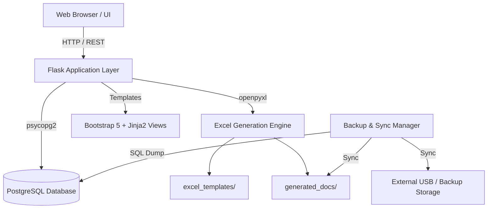

# BioTrack IMS — Enterprise Warehouse, Order & Inventory Management System

[](https://www.python.org/)
[](https://flask.palletsprojects.com/)
[](https://www.postgresql.org/)
[](LICENSE)

A production-ready, full-stack enterprise web application for inventory control, quotation workflow, order fulfillment, warehouse lot management (FEFO), automated document generation, and incremental multi-destination backup synchronization.

---

## Highlights & Core Capabilities

- **Complete Quote-to-Order Lifecycle**:
  - Multi-item quotation builder with automated CAD tax, discount, and shipping calculators.
  - Seamless one-click conversion from approved Quote to confirmed Order.
  - Dynamic payment tracking (Paid / Unpaid) and fulfillment pipeline (Pending / Fulfilled).
  - Revision history and version tracking for quotes and customer references.

- **Warehouse & Lot Management (FEFO)**:
  - Base SKU grouping with support for variable package sizes and sub-SKUs.
  - **FEFO (First-Expired, First-Out)** lot tracking with automated shelf-life warnings.
  - Real-time distinction between physical on-hand inventory, reserved stock, and net available stock.
  - Automated shortage detection highlighting order fulfillment risks.

- **Automated Excel Document Generation**:
  - Dynamically populates professional office templates for **Invoices**, **Packing Slips**, **Quotes**, and **Shipping Labels**.
  - Intelligent coordinate mapping preserving formulas, cell borders, and merged header structures.
  - On-demand browser viewing and direct download.

- **Product Catalog Synchronization**:
  - Automated parser for supplier Excel spreadsheets (`.xlsx`).
  - High-throughput diffing: inserts new SKUs, updates modified pricing/names, and skips unchanged records without locking the database.

- **Enterprise Backup & External Drive Sync**:
  - Standalone multi-target backup engine.
  - Dumps consistent relational PostgreSQL schema and datasets into versioned SQL scripts.
  - Incremental document synchronization with external hard drive / USB auto-detection.
  - Automated historical retention pruning.

---

## Architecture & Tech Stack



- **Backend**: Python 3.11+, Flask, `psycopg2-binary`, `openpyxl`, `Werkzeug`, `Gunicorn`
- **Frontend**: Responsive HTML5, Bootstrap 5.3, Bootstrap Icons, Vanilla JavaScript
- **Database**: PostgreSQL 14+ / 16
- **Tooling**: Docker, Docker Compose, Visual Studio Code DevContainers

---

## Quickstart Guide

### Option 1: Docker Compose / DevContainer (Recommended)

1. Clone or open the repository in VS Code:
   ```bash
   git clone <your-repo-url>
   cd portfolio
   ```
2. Open in VS Code and select **"Reopen in Container"** when prompted, or run:
   ```bash
   docker compose -f .devcontainer/docker-compose.yml up -d
   ```
3. The PostgreSQL database will initialize automatically with `schema.sql` and `backup_data.sql`.
4. Open [http://localhost:5000](http://localhost:5000) in your browser. Default portal password is `admin`.

---

### Option 2: Local Python Environment

#### 1. Prerequisites
- Python 3.11+
- PostgreSQL server running locally or via Docker

#### 2. Environment Setup
```bash
# Create and activate virtual environment
python -m venv venv

# Windows
venv\Scripts\activate
# Linux/macOS
source venv/bin/activate

# Install dependencies
pip install -r requirements.txt
```

#### 3. Database Setup
Create your PostgreSQL database and initialize schema and seed data:
```bash
createdb -U postgres inventory_db
psql -U postgres -d inventory_db -f schema.sql
psql -U postgres -d inventory_db -f backup_data.sql
```

#### 4. Configure Environment
Copy the example environment configuration:
```bash
cp .env.example .env
```
Edit `.env` to match your local database credentials if needed:
```env
FLASK_SECRET_KEY=change_me_to_a_secure_random_key
APP_PASSWORD=admin
DB_HOST=localhost
DB_PORT=5432
DB_NAME=inventory_db
DB_USER=postgres
DB_PASS=postgres
```

#### 5. Run the Application
```bash
python app.py
```
Visit `http://localhost:5000` in your web browser.

---

## Repository Structure

```text
portfolio/
├── .devcontainer/              # VS Code dev container & Docker Compose specs
│   ├── devcontainer.json
│   └── docker-compose.yml
├── excel_templates/            # Formatted templates for document generator
│   ├── invoice_template.xlsx
│   ├── label_template.xlsx
│   ├── packing_template.xlsx
│   └── quote_template.xlsx
├── generated_docs/             # Runtime output directory for generated files
│   └── .gitkeep
├── templates/                  # Jinja2 HTML templates
│   ├── documents.html          # File explorer & backup administration UI
│   ├── index.html              # Main dashboard (quotes, orders, customers)
│   ├── login.html              # Portal authentication screen
│   └── warehouse.html          # Inventory, lot tracking & catalog sync
├── .env.example                # Configuration blueprint
├── .gitignore                  # Git ignore rules
├── app.py                      # Flask core application & routing
├── backup_data.sql             # Sanitized mock data seed
├── backup_manager.py           # Standalone automated backup & USB sync engine
├── export_db.py                # Database export utility
├── import_excel.py             # Product catalog Excel import script
├── requirements.txt            # Python dependencies
├── schema.sql                  # PostgreSQL database DDL schema
├── LICENSE                     # MIT License
└── README.md                   # Project documentation
```

---

## Configuration Reference

| Environment Variable | Description | Default |
| :--- | :--- | :--- |
| `FLASK_SECRET_KEY` | Secret key used for session cookie signing | `dev_secret_key_change_in_production` |
| `APP_PASSWORD` | Access password required on the login portal | `admin` |
| `DB_HOST` | PostgreSQL hostname / IP address | `localhost` |
| `DB_PORT` | PostgreSQL port | `5432` |
| `DB_NAME` | Database name | `inventory_db` |
| `DB_USER` | Database username | `postgres` |
| `DB_PASS` | Database password | `postgres` |
| `BACKUP_TARGET` | Destination path for backup archives | Auto-detected drive or `local_backups/` |

---

## Standalone Utilities

### 1. Catalog Import CLI
Import or update inventory items directly from an Excel sheet:
```bash
python import_excel.py path/to/catalog.xlsx "Primary Supplier"
```

### 2. Manual Backup & External Drive Sync
Run a full database dump and file sync to a connected drive:
```bash
# Detect connected USB / external drives
python backup_manager.py --list-drives

# Execute backup to target location
python backup_manager.py --target "E:\Backups"
```

### 3. Database Export
Export live PostgreSQL database records to SQL insert statements:
```bash
python export_db.py backup_data.sql
```

---

## License

This project is licensed under the MIT License - see the [LICENSE](LICENSE) file for details.
